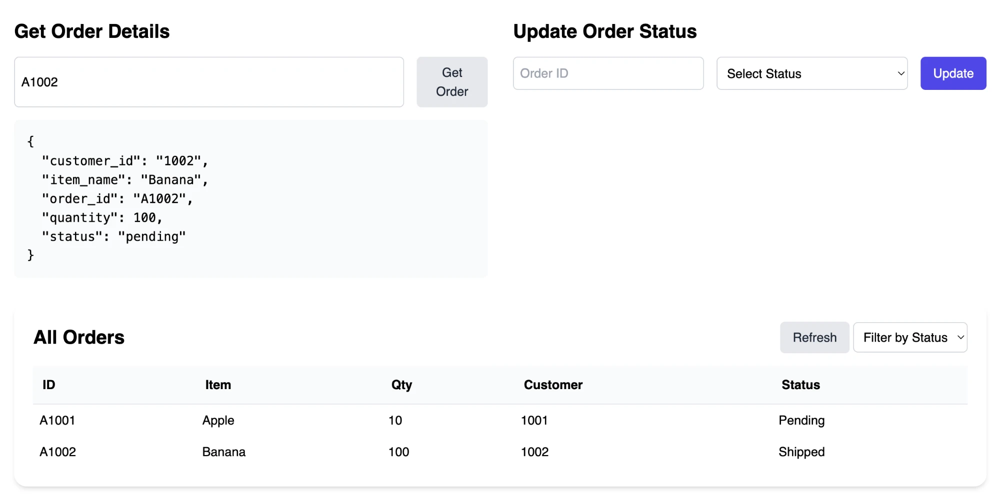

# Udatracker

A small order-tracking app built test-first with Flask. The business logic lives in `backend/order_tracker.py`, the REST API in `backend/app.py`, and storage in `backend/in_memory_storage.py`.

```
.
├── backend
│   ├── __init__.py
│   ├── app.py
│   ├── in_memory_storage.py
│   ├── order_tracker.py
│   ├── requirements.txt
│   └── tests
│       ├── __init__.py
│       ├── test_api.py
│       ├── test_api_extended.py
│       └── test_order_tracker.py
├── frontend
│   ├── css
│   │   └── style.css
│   ├── index.html
│   └── js
│       └── script.js
├── media
│   └── app-running-locally.webp
├── Dockerfile
├── pytest.ini
└── README.md
```

## Running

From this directory (`starter/`):

```bash
pip install -r backend/requirements.txt
pytest
python -m backend.app
```

Then open `http://127.0.0.1:5000/`.



With Docker:

```bash
docker build -t udatracker .
docker run -p 5000:5000 udatracker
```

## API Reference

Valid statuses are `pending`, `processing` and `shipped`. Errors always return `{"error": "<message>"}` with `400` for validation failures and `404` for unknown orders.

| Method | Path | Body / Query | Success |
|---|---|---|---|
| `POST` | `/api/orders` | `order_id`, `item_name`, `quantity`, `customer_id`, optional `status` | `201` + order |
| `GET` | `/api/orders/<order_id>` | | `200` + order |
| `PUT` | `/api/orders/<order_id>/status` | `new_status` | `200` + updated order |
| `DELETE` | `/api/orders/<order_id>` | | `204` |
| `GET` | `/api/orders` | optional `status`, `customer_id` | `200` + list of orders |

```bash
curl -X POST http://127.0.0.1:5000/api/orders \
  -H "Content-Type: application/json" \
  -d '{"order_id": "ORD001", "item_name": "Laptop", "quantity": 1, "customer_id": "CUST001"}'

curl http://127.0.0.1:5000/api/orders/ORD001

curl -X PUT http://127.0.0.1:5000/api/orders/ORD001/status \
  -H "Content-Type: application/json" \
  -d '{"new_status": "shipped"}'

curl "http://127.0.0.1:5000/api/orders?customer_id=CUST001&status=shipped"

curl -X DELETE http://127.0.0.1:5000/api/orders/ORD001
```

## Reflection

- **Design decision:** all validation lives in `OrderTracker`, so the routes stay thin and pass request values straight through. Two Flask error handlers map `ValueError` to `400` and `OrderNotFoundError` to `404`, giving the frontend a consistent `{"error": ...}` response.
- **Trade-off:** `get_order_by_id` returns `None` for a missing order, mirroring the storage interface, while `update_order_status` and `delete_order` raise because they cannot continue without an order.
- **Testing insight:** the parametrized quantity test includes `True`, which a plain `isinstance(quantity, int)` check accepts because `bool` subclasses `int`. The test forced an explicit `bool` check.
- **Next steps:** persistent SQLite storage behind the same interface, refreshing the order details panel after a status update, and enforcing status transitions so a shipped order cannot return to pending.
